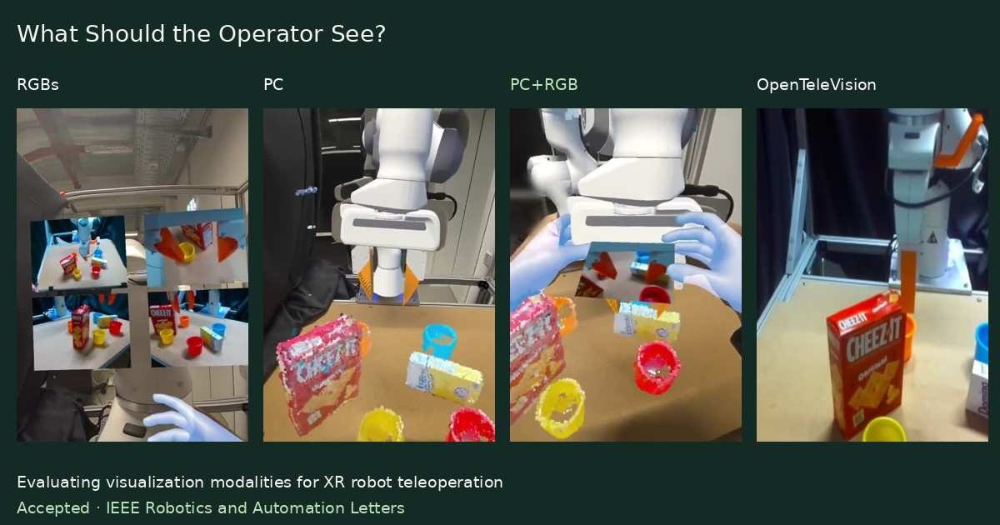

<div align="center">

# What Should the Operator See?
### Evaluating Visualization Modalities for XR Robot Teleoperation

**Accepted to IEEE Robotics and Automation Letters (RA-L)**

[](https://enesulasdincer.github.io/What-Should-the-Operator-See/)
[](https://enesulasdincer.github.io/What-Should-the-Operator-See/recordings.html)
[](https://arxiv.org/abs/2604.03730)

[Enes Ulas Dincer](https://enesulasdincer.github.io/),
[Manuel Zaremski](https://www.ifab.kit.edu/english/287_2138.php),
[Alexandra Nick](https://www.ifab.kit.edu/english/287_2936.php),
Elias Wucher,
[Barbara Deml](https://www.ifab.kit.edu/english/287_1194.php),
[Gerhard Neumann](https://alr-kit.de/team/geri/)

Karlsruhe Institute of Technology (KIT)

[Website](https://enesulasdincer.github.io/What-Should-the-Operator-See/) · [Documentation](Documentation/documentation.md) · [Supplement](supplementary_material.pdf) · [Citation](#citation)



</div>

This repository contains the XR teleoperation systems used to investigate how visualization affects human performance in contact-rich manipulation. The system combines a fused multi-view point cloud with high-resolution wrist-camera feedback, evaluated against multi-view RGB streams, point clouds alone, and an OpenTeleVision-based stereo baseline under the same leader–follower control loop.

The earlier [arXiv preprint](https://arxiv.org/abs/2604.03730) is titled *A Multi-View 3D Telepresence System for XR Robot Teleoperation*. The accepted paper uses the title above. Final publication details will be added when available.

## Visualization modalities

| Modality | Operator view | Implementation |
|---|---|---|
| **RGBs** | Four high-resolution camera streams displayed on virtual screens. | [Unity project](UnityProjects/RGBs) |
| **PC** | Semantically filtered, fused multi-view point cloud with explicit 3D workspace structure. | [Unity project](UnityProjects/PC) |
| **PC+RGB** | Fused point cloud plus a wrist-mounted RGB stream near the virtual end-effector. | [Unity project](UnityProjects/PC+RGB) |
| **OT** | Ego-centric stereo-video baseline based on OpenTeleVision. | [Upstream OpenTeleVision](https://github.com/OpenTeleVision/TeleVision) |

## Recordings

The [interactive comparison](https://enesulasdincer.github.io/What-Should-the-Operator-See/#explore) lets you switch tasks and play the four operator views together. All 12 complete recordings are included in this repository.

| Task | RGBs | PC | PC+RGB | OT |
|---|---|---|---|---|
| Cup insertion | [MP4](docs/assets/videos/rgbs-cup-insertion.mp4) | [MP4](docs/assets/videos/pc-cup-insertion.mp4) | [MP4](docs/assets/videos/pc-rgb-cup-insertion.mp4) | [MP4](docs/assets/videos/ot-cup-insertion.mp4) |
| T-shape assembly | [MP4](docs/assets/videos/rgbs-t-shape-assembly.mp4) | [MP4](docs/assets/videos/pc-t-shape-assembly.mp4) | [MP4](docs/assets/videos/pc-rgb-t-shape-assembly.mp4) | [MP4](docs/assets/videos/ot-t-shape-assembly.mp4) |
| Wire-loop | [MP4](docs/assets/videos/rgbs-wire-loop.mp4) | [MP4](docs/assets/videos/pc-wire-loop.mp4) | [MP4](docs/assets/videos/pc-rgb-wire-loop.mp4) | [MP4](docs/assets/videos/ot-wire-loop.mp4) |

These are individual demonstrations, not matched trials or study averages. Immersive VR recordings are projected into 2D and can appear distorted. Videos retain the original compressed video and audio streams and start muted in the comparison player. “Play all” restarts the clips together; it does not align events between recordings.

## Main-study findings

In a controlled within-subject study, **31 participants** experienced all four visualizations across **cup insertion, T-shape assembly, and wire-loop placement**.

| Modality | Mean completion time ↓ | Overall success rate ↑ |
|---|---:|---:|
| **PC+RGB** | **44.13 s** | **97.31%** |
| PC | 51.66 s | 94.09% |
| OT | 56.54 s | 91.67% |
| RGBs | 70.26 s | 89.78% |

Completion times include failed trials assigned the **120 s task limit** before participant-level aggregation. The findings concern the tested leader–follower system and tasks. PC+RGB had the lowest overall mean time and highest observed success rate; the latter does not imply a statistically significant difference from every other modality.

## System and code

The visualization system builds on [IRIS](https://intuitive-robots.github.io/iris-project-page/), adding multi-camera point-cloud fusion, semantic filtering, calibrated workspace alignment, and wrist-camera RGB feedback.

- **Sensing:** three static Intel RealSense RGB-D cameras and a wrist-mounted RGB-D camera.
- **Rendering:** GPU-accelerated point clouds and robot meshes in Unity on Meta Quest 3.
- **Control:** two Franka Emika Panda robots in a leader–follower setup, using Polymetis.
- **Unity version:** `6000.0.24f1` (see each project's `ProjectSettings/ProjectVersion.txt`).

| Directory | Contents |
|---|---|
| [`UnityProjects/`](UnityProjects) | Headset applications for RGBs, PC, and PC+RGB. |
| [`streamer/`](streamer) | RGB, point-cloud, segmentation, robot, and joint-streaming scripts. |
| [`Documentation/`](Documentation/documentation.md) | Pipeline explanations, scene entry points, rendering details, and deployment notes. |
| [`Documents/`](Documents) | Existing evaluation and questionnaire materials. |
| [`docs/`](docs) | Static GitHub Pages website, recordings, posters, and paper assets. |

Python packages are listed in [`requirements.txt`](requirements.txt). Robot operation also requires the relevant hardware, calibration, networking, headset configuration, and control environment described in the [documentation](Documentation/documentation.md).

## Website maintenance

GitHub Pages serves the [`docs/`](docs) directory from `main`. No build or Node dependencies are required.

```bash
python3 -m http.server 8000 --directory docs
```

Open `http://localhost:8000`. Edit [`docs/index.html`](docs/index.html), [`docs/styles.css`](docs/styles.css), and [`docs/script.js`](docs/script.js) to update the page. [`docs/recordings.html`](docs/recordings.html) exposes every recording without JavaScript. For new publication details, update the website citation, this README, and [`CITATION.cff`](CITATION.cff).

## Citation

```bibtex
@article{dincer2026operator,
  title = {What Should the Operator See? Evaluating Visualization Modalities for XR Robot Teleoperation},
  author = {Dincer, Enes Ulas and Zaremski, Manuel and Nick, Alexandra and Wucher, Elias and Deml, Barbara and Neumann, Gerhard},
  journal = {IEEE Robotics and Automation Letters},
  year = {2026},
  note = {Accepted for publication}
}
```

## Acknowledgements

This project builds on IRIS and uses the OpenTeleVision baseline. Existing third-party source attributions and license notices are retained in the code and bundled dependencies. Paper authorship is listed above; the GitHub repository is maintained by [Enes Ulas Dincer](https://github.com/EnesUlasDincer).
